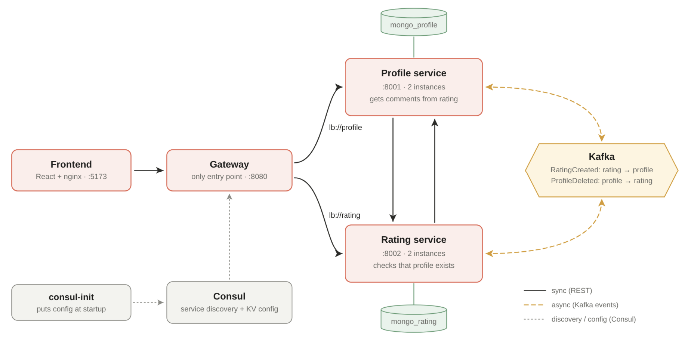

# Profile Rater

This project was made for the exam in PG3402 Microservices

Profile Rater is a playful web application that lets you post your dating profile
and receive feedback. It is for dating-app users who want to optimize their profile
to get more interaction, and for those who want to help others with constructive
feedback. It is anonymous, you can write two bios and see which one performs best
(A/B test), and all you need is your owner code to keep track of everything.

## Architecture



- **frontend:** React app served by nginx. Talks only to the gateway.
- **gateway:** the only entry point. Routes `/profiles/**` to profile and `/ratings/**` to rating.
- **profile:** creates, shows and deletes profiles. Keeps score totals and calculates results.
- **rating:** stores ratings and comments. Makes sure a browser rates a profile only once.
- **Kafka:** sends events between profile and rating.
- **Consul:** service discovery and central configuration.
- **MongoDB:** one database per service, `mongo_profile` and `mongo_rating`.

### Communication

- **Synchronous (REST):** rating calls profile (`GET /profiles/{id}`) through Consul to check that the profile exists before saving a rating. If profile is down, rating answers `503`.
- **Asynchronous (Kafka):**
  - `rating-created` (rating → profile): profile updates the score totals.
  - `profile-deleted` (profile → rating): rating deletes all ratings for that profile.
- **Load balancing and health:** profile and rating run in 2 instances each. Consul health-checks `/actuator/health`, and the gateway (`lb://`) only sends traffic to healthy instances.

## How to run

### Requirements

- Docker Desktop
- Git
- For local development: Java 21 and Node 22

> **Windows users:** Use `127.0.0.1` instead of `localhost`. `localhost` can resolve to IPv6 (`::1`) and give "Connection reset". In PowerShell, use `curl.exe` instead of `curl`.

### Startup procedure (Docker)

**1. Clone the repository**

```bash
git clone https://github.com/tezzzxx/Profile-rater.git
cd Profile-rater
```

**2. Build and start everything**

```bash
docker compose up --build -d
```

**3. Running**

- Frontend: http://127.0.0.1:5173 
- Gateway: http://127.0.0.1:8080 
- Consul UI: http://127.0.0.1:8500 
- Swagger (rating): http://127.0.0.1:8080/rating-docs/swagger-ui.html 

**4. Checks**

- **Containers**: all should be `running` or `healthy`:
  ```bash
  docker compose ps
  ```
- **Consul UI** (http://127.0.0.1:8500): `gateway`, `profile` (2 instances) and `rating` (2 instances) should all be green.
- **Gateway health:**
  ```bash
  curl.exe http://127.0.0.1:8080/actuator/health
  # {"status":"UP"}
  ```
- **Create a test profile** through the gateway:
  ```bash
  curl.exe -i -X POST http://127.0.0.1:8080/profiles -H "Content-Type: application/json" -d "@profile/profile.json"
  # HTTP/1.1 201 Created  {"id":"...","ownerCode":"..."}
  ```

**5. Stop**

```bash
docker compose down # stop     
docker compose down -v # stop and delete all data
```

### Startup procedure (local development)

**1. Start the infrastructure in Docker**

```bash
docker compose up -d consul consul-init kafka mongo_profile mongo_rating
```

**2. Start the backend**

Run `GateawayApplication`, `ProfileApplication` and `RatingProfileApplication` from IntelliJ.

**3. Start the frontend**

```bash
cd frontend
npm install
npm run dev
```

> Do not run the same service in IntelliJ and Docker at the same time. Both instances register in Consul and requests are sent to both.

### Build and test with Maven

```bash
cd rating
./mvnw clean package -DskipTests # build only
./mvnw test # integration tests (Docker must be running)
```
The same commands work in `gateway/` and `profile/`. On Windows use `.\mvnw`.

### Test data

- `profile/profile.json`: example body for `POST /profiles`
- `rating/rating.json`: example body for `POST /ratings` (replace `profileId` with an existing id first)

```bash
curl.exe -i -X POST http://127.0.0.1:8080/ratings -H "Content-Type: application/json" -d "@rating/rating.json"
# HTTP/1.1 201 Created
```

## User stories

### 1. Post my profile for others to rate

1. Click post in the menu
2. Write my age, my location, the image I want to use (as an url) and two different bios
3. Click submit. Copy and save my owner code(Example: 68V-EEPH). Use the owner code later to check my ratings or delete my profile

**Via API:**
```bash
curl.exe -i -X POST http://127.0.0.1:8080/profiles -H "Content-Type: application/json" -d "@profile/profile.json"
# HTTP/1.1 201 Created
# {"id":"6afc23a32f056d4d85966d57","ownerCode":"K8V-EEPH"}
```

**Behind the scenes:** gateway → profile. Profile stores the profile in `mongo_profile` and generates a unique owner code. There is no login. The owner code works as the owner's credential.

### 2. Rate others profile 

1. Click rating in the menu. Get a profile, shown with bio A or B
2. Score bio, picture and give an overall rating from 1-5. Write an optional comment
3. Submit and the next profile will be shown automatically. When there is no more profiles, "All done!" will be shown

**Via API** (replace `profileId` in `rating/rating.json` with an id from story 1):
```bash
curl.exe -i -X POST http://127.0.0.1:8080/ratings -H "Content-Type: application/json" -d "@rating/rating.json"
# HTTP/1.1 201 Created
```

**Behind the scenes:**
- **Synchronous:** rating calls profile through Consul (REST) to check that the profile exists.
- **Asynchronous:** rating saves the rating in `mongo_rating` and publishes a `RatingCreated` event to Kafka (`rating-created`). Profile consumes it and updates the score totals.
- The rater is anonymous: the browser stores a random rater id in `localStorage`.

### 3. Check the results for my profile

1. Click result in the menu
2. Write the owner code saved from before and click show results
3. See how many have rated you, the average score for photo, bios (Both bio A and B) and the overall impression and the comments, newest first

**Via API:**
```bash
curl.exe http://127.0.0.1:8080/profiles/results/K8V-EEPH
# HTTP/1.1 200 OK
# {"profileId":"...","ratingCount":3,"minRatingsToShow":1,"ready":true,
#  "scores":{"photos":4.0,"bio":3.7,"overall":4.3},
#  "bioTest":{"a":{"average":3.5,"count":2},"b":{"average":4.0,"count":1}},
#  "comments":[...]}
```

**Behind the scenes:** the scores and A/B totals are calculated in profile from the `RatingCreated` events it has consumed from Kafka. The comments are fetched synchronously from rating (`GET /ratings/profile/{profileId}`) through Consul. Because the score totals are updated through Kafka, the results are **eventually consistent** and can be a moment behind right after a new rating.

### 4. Delete my profile

1. Click result in the menu. Write the owner code saved from before and click show results
2. Click delete profile at the bottom and confirm
3. You will see "Your profile and all its ratings have been deleted".
4. Writing the owner code for the profile that was just deleted will show "No profile found with that owner code"

**Via API:**
```bash
curl.exe -i -X DELETE http://127.0.0.1:8080/profiles/K8V-EEPH
# HTTP/1.1 204 No Content

curl.exe -i http://127.0.0.1:8080/profiles/results/K8V-EEPH
# HTTP/1.1 404 Not Found
```

**Check that the ratings were deleted too** (With an ID):
```bash
curl.exe http://127.0.0.1:8080/ratings/profile/<profileId>
# []

docker compose logs rating | Select-String "Deleted"
# rating-1  | ... Deleted 3 ratings for deleted profile 6afc23a32f056d4d85966d57
```

**Behind the scenes:** profile deletes the profile and publishes a `ProfileDeleted` event to Kafka (`profile-deleted`). Rating consumes the event and deletes all ratings for that profile. Only one of the two rating instances handles each event, because they share the consumer group `rating`.

## Microservice features

### Central configuration (Consul KV)

Configuration is stored in Consul KV and read by the services at runtime (`spring.config.import=optional:consul:`).

**Keys in Consul KV:**

- `config/rating/rating.max-score`: highest allowed score (default `5`)
- `config/profile/profile.min-ratings`: number of ratings before results are shown (default `1`)

**Try it:**
1. Send a rating with a score of 8 (edit `rating/rating.json`, for example `"picRating": 8`, with a profile you have not rated yet):
   ```bash
   curl.exe -i -X POST http://127.0.0.1:8080/ratings -H "Content-Type: application/json" -d "@rating/rating.json"
   # HTTP/1.1 400 Bad Request
   # {"error":"picRating must be between 1 and 5"}
   ```
2. Change the max score in Consul, either in the Consul UI (http://127.0.0.1:8500 → **Key/Value** → `config/rating/rating.max-score`) or with:
   ```bash
   docker exec consul consul kv put config/rating/rating.max-score 10
   # Success! Data written to: config/rating/rating.max-score
   ```
3. Wait a few seconds and send the same rating again. No restart needed:
   ```bash
   # HTTP/1.1 201 Created
   ```
4. Set it back:
   ```bash
   docker exec consul consul kv put config/rating/rating.max-score 5
   ```

### Multiple instances, load balancing and health checks

Profile and rating run in **2 instances each** (`deploy.replicas: 2` in `docker-compose.yml`). Every instance registers in Consul, and Consul health-checks it on `/actuator/health` every 10 seconds. The gateway uses `lb://profile` and `lb://rating`, so requests are load balanced between the healthy instances only.

**See the instances:**
- Consul UI (http://127.0.0.1:8500) → **Services** → `rating` shows 2 instances, both green.
- Or in the terminal:
  ```bash
  docker compose ps
  # profile-rater-rating-1   ...   Up (healthy)
  # profile-rater-rating-2   ...   Up (healthy)
  ```

**Load balancing:** send a few ratings (story 2) and follow the logs. Both instances handle requests:
```bash
docker compose logs -f rating
# rating-1  | ... Sent RatingCreated for rating ...
# rating-2  | ... Sent RatingCreated for rating ...
```

**Stop one instance:**
1. Stop one of the rating instances:
   ```bash
   docker stop profile-rater-rating-1
   ```
2. In the Consul UI the instance turns **red** (critical) after a few seconds, and it is removed after 1 minute.
3. Use the frontend or send a new rating. Everything still works, because the gateway only sends traffic to `rating-2`:
   ```bash
   # HTTP/1.1 201 Created
   ```
4. Start it again. It registers in Consul and gets traffic again when it is healthy:
   ```bash
   docker start profile-rater-rating-1
   ```
## Scope changes and simplifications

We reduced the scope from the arbeidskrav to the core feature, feedback and scoring, and dropped login, matching, chat and events. We chose to build one complete feature with all the microservice requirements instead of several half-finished ones. The reasoning is discussed in our reflection documents.

- **No login:** the owner gets an owner code, raters get an anonymous id stored in the browser.
- **Ratings from people, not AI:** other users rate the profile instead of an automatic evaluation.
- **Photos as URL:** no file upload.
- **Bio A/B test (new):** replaces "edit the profile and get new feedback". The owner writes two bios and the results compare them.
- **Eventual consistency:** results are updated through Kafka and can be a moment behind.

## Team contributions

We split the work by service, so that each of us owned one service from database to Kafka, and shared the work that connects them.

**Thea (Candidate number: 13)**
- **rating service:** REST API, validation and error handling, MongoDB, REST client to profile through Consul, `RatingCreated` producer and `ProfileDeleted` consumer
- **gateway:** routing, load balancing through Consul and CORS
- Integration tests in rating with Testcontainers
- Swagger/OpenAPI for rating
- GitHub Actions pipeline
- Frontend: project setup, the **Rating** page and the **Result** page
- README

**Natalia (Candidate number: 11)**
- **profile service:** REST API, owner codes, bio A/B selection, score totals and results, `RatingCreated` consumer and `ProfileDeleted` producer, REST client to rating
- `docker-compose.yml` with multiple instances and health checks
- Consul setup and central configuration (`init-kv.sh`)
- Tests in profile
- Frontend: the **Post** page and the styling (`index.css`)
- Architecture diagram

**Together**
- Planning, prioritizing the user stories and reducing the scope
- Testing the whole flow end to end